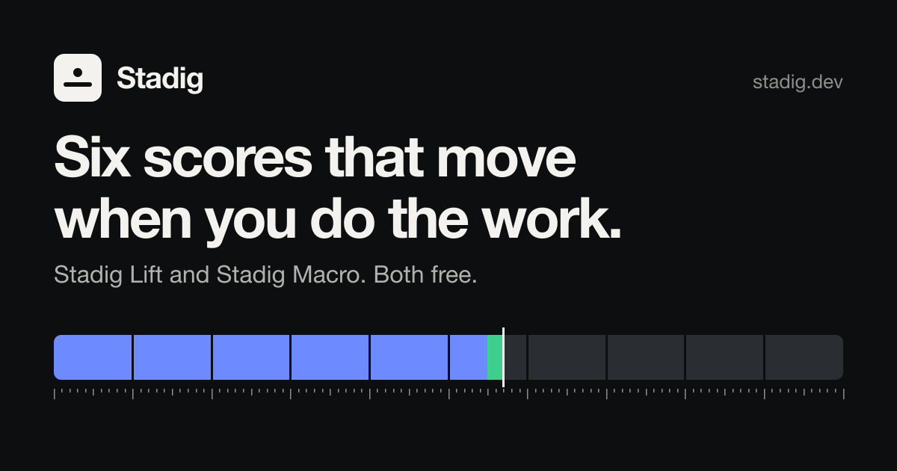
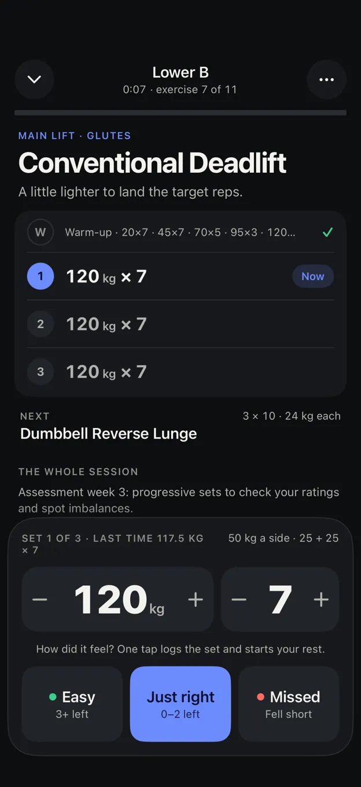
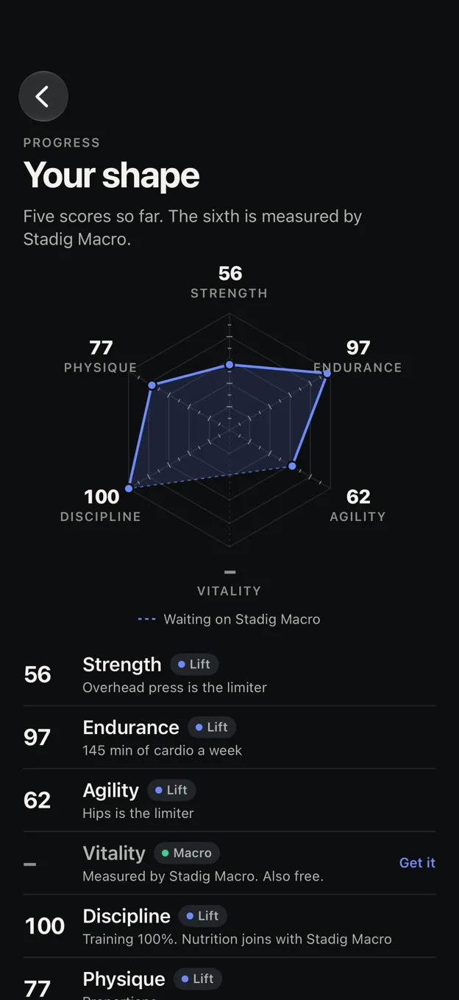
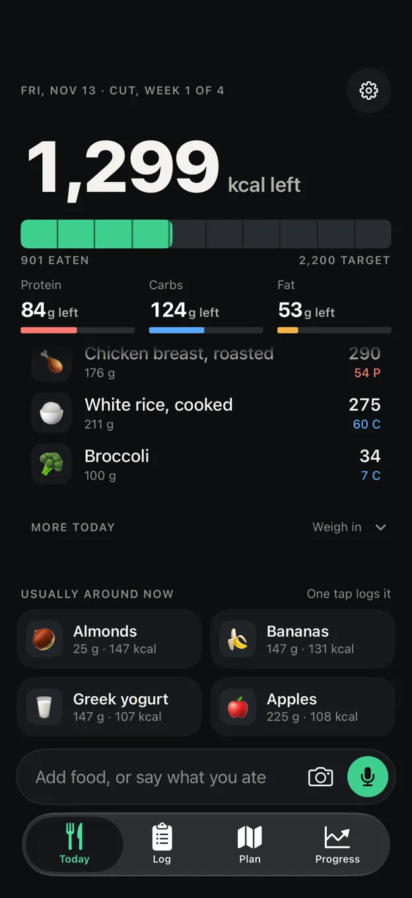
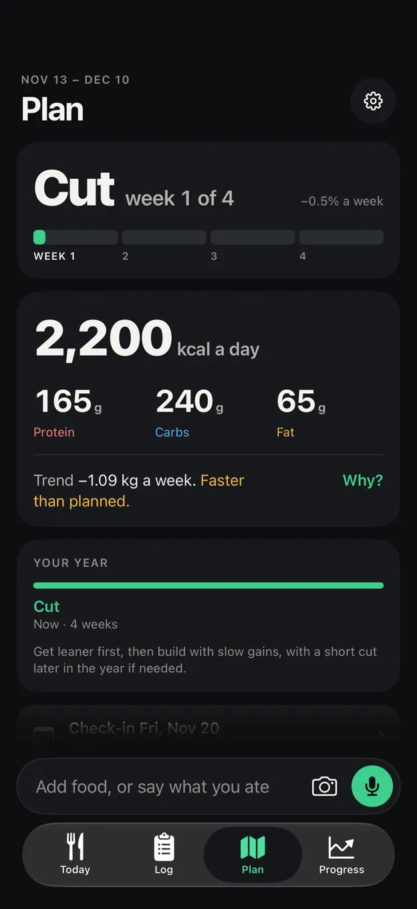
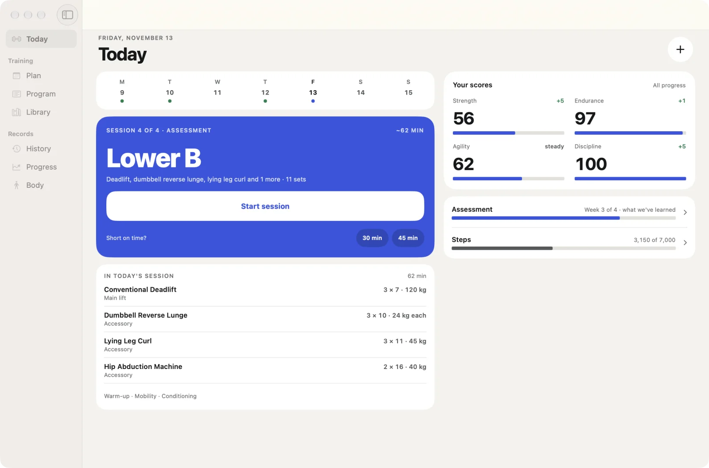
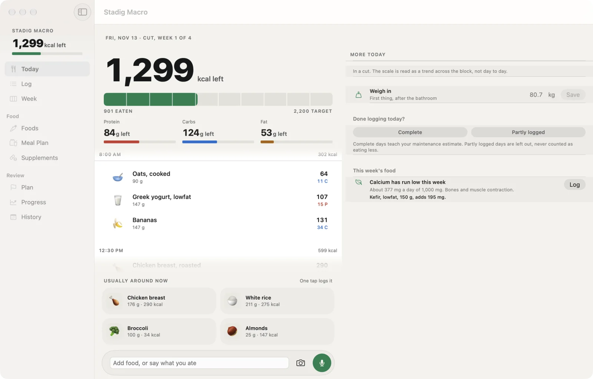
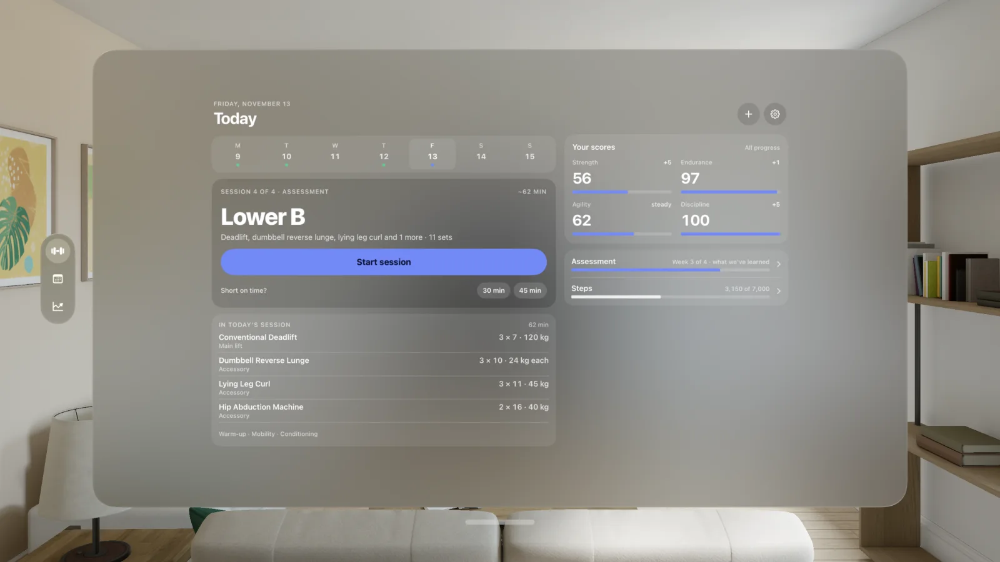
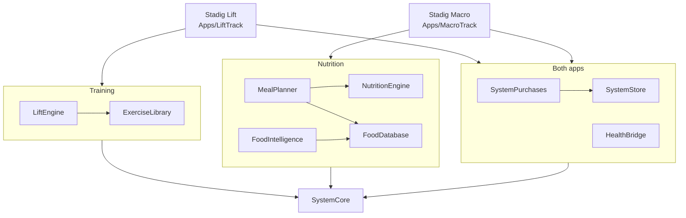

<p align="center">
  <a href="https://stadig.dev"></a>
</p>

<h1 align="center">Stadig Lift and Stadig Macro</h1>

<p align="center">
  <b>Two free fitness apps for iPhone, iPad, Mac, Apple Vision Pro and Apple Watch.</b><br>
  Native SwiftUI over ten local Swift packages. No account, no server, no third-party code. All of it is here.
</p>

<p align="center">
  <a href="https://stadig.dev">stadig.dev</a> ·
  <a href="docs/screenshots.md">Screenshots</a> ·
  <a href="docs/building.md">Build it</a> ·
  <a href="docs/architecture.md">Architecture</a> ·
  <a href="docs/README.md">All the docs</a>
</p>

<p align="center">
  
  
  
  
</p>

**Stadig** (STAH-dig, Norwegian for steady) is a small family of fast, offline-first fitness apps. They don't just chart trends. They tell you what to do next, and every insight ends in a concrete action.

This repository is everything behind them: both apps, the packages that hold their logic, the tests, the build scripts, the App Store listing and the website.

## The apps

<table>
<tr>
<td width="50%" valign="top">
<h3> Stadig Lift</h3>
<p>The training app: every session prescribed, and every set adjusted to how it went.</p>
<p>On the iPad and the Mac it's also where you study the program, the exercise library and your history. An iPad in the gym runs the session in two panes. The Watch logs and rates sets, and times rest by heart rate.</p>
<p><a href="https://apps.apple.com/app/stadig-lift/id6824198193">Stadig Lift on the App Store</a> · <a href="docs/lift.md">How it works</a></p>
</td>
<td width="50%" valign="top">
<h3> Stadig Macro</h3>
<p>The nutrition app. It learns your real maintenance from what you log and your weigh-ins, recommends one phase (a cut, a bulk, maintenance and the rest) with its reasons, and adapts your targets each week.</p>
<p>A visit is a glance and a tap: search, scan, a photo or a sentence, with Apple's on-device model and Private Cloud Compute doing the reading. On the iPad and the Mac it adds a food table, the meal plan as a week and a history of every day.</p>
<p><a href="https://apps.apple.com/app/stadig-macro/id6824204323">Stadig Macro on the App Store</a> · <a href="docs/macro.md">How it works</a></p>
</td>
</tr>
</table>

<p align="center">
  
  
</p>
<p align="center">
  
</p>
<p align="center"><sub>The same target on the Mac and on Apple Vision Pro. <a href="docs/screenshots.md">Every screen on every device</a>.</sub></p>

## What's in here for a developer

- **One target, five platforms.** Each app is a single multiplatform SwiftUI target for iPhone, iPad, the Mac and Apple Vision Pro, with a Watch app beside it. Screens choose a layout by size class, and what differs between platforms is spelled in one file, not scattered through `#if`.
- **The logic is in packages, with tests.** Rules, calculations, planning and parsing live in ten local Swift packages; the apps are thin shells of views over them. The packages carry more than 1,000 tests, among them simulated users who train for twelve weeks through the real progression code.
- **No dependencies and no backend.** Apple frameworks only. A person's data stays on their devices and in their own iCloud, and the two apps share through an App Group container with versioned payloads.
- **Offline food catalogs.** USDA FoodData Central, Open Food Facts and the NIH supplement label database, built by scripts in this repo, with search, barcodes and label reading on the device.
- **Apple's models for logging.** A photo or a spoken sentence becomes a meal through Apple's Foundation Models framework, on the device or with Private Cloud Compute. The model only names the foods and the amounts; the nutrients always come from the catalog.
- **Swift 6, strict concurrency, zero warnings.** Observation for state, and CI treats every warning as an error.
- **Generated Xcode projects.** `Scripts/generate-project.py` writes the projects, schemes and test plans, and CI fails if they drift.
- **Built with coding agents, in the open.** The rules they work to, the skills they follow and the notes they keep are all in the repo ([below](#working-with-coding-agents)).



What each package holds, and where new code goes: [docs/architecture.md](docs/architecture.md).

## Build it

You need Xcode 27 and nothing else.

```sh
git clone https://github.com/swsvindland/the-system.git
cd the-system
Scripts/build.sh test                    # every package's tests
Scripts/fetch-catalogs.sh                # optional: Stadig Macro's packaged foods and supplements (needs gh signed in)
open Apps/LiftTrack/LiftTrack.xcodeproj  # or Apps/MacroTrack/MacroTrack.xcodeproj
```

Simulator builds, and Mac builds through `Scripts/build.sh`, need no developer account. Launch a DEBUG build with `-inMemoryStore -seedSampleData` to see an app with data in it. The rest is in [docs/building.md](docs/building.md).

## Docs

| | |
|---|---|
| [Screenshots](docs/screenshots.md) | Both apps on every device |
| [Building and running](docs/building.md) | The first build, everyday commands, building without a developer account |
| [Architecture](docs/architecture.md) | The packages, where code goes, how the apps talk to each other |
| [Stadig Lift](docs/lift.md) and [Stadig Macro](docs/macro.md) | How each app works, screen by screen and rule by rule |
| [The design](docs/design.md) | The palette, the numerals, the ruler, and what each device is for |
| [Testing](docs/testing.md) | What's tested where, and [what the package tests cover](docs/package-tests.md) |
| [CI/CD](docs/ci-cd.md) | GitHub Actions, Xcode Cloud, branches and releases |
| [The food catalogs](Apps/MacroTrack/Catalogs/README.md) | Building them from source, and [their licences](Packages/FoodDatabase/Sources/FoodDatabase/Resources/ATTRIBUTION.md) |

## Working with coding agents

Stadig is built with coding agents (Claude Code), and how that's done is part of the repo:

- [CLAUDE.md](CLAUDE.md) is the rulebook: the commands, where code goes, the conventions, what a change has to pass before it's called done. It's a good checklist for people too. [AGENTS.md](AGENTS.md) points other tools at it.
- [.claude/skills/](.claude/skills) has the step-by-step skills: build and test, run an app in the simulator, add a feature, review a change, commit beside other sessions, release.
- [agent-docs/](agent-docs/README.md) is what the agents write down as they go: every product call made without the owner's sign-off, and what was and wasn't checked by hand.

## Licence

Stadig Lift and Stadig Macro are copyright © 2026 Sam Svindland, and free software under the [GNU General Public License, version 3](LICENSE).

The licence covers the code. The food data has its own terms: USDA FoodData Central and the NIH Dietary Supplement Label Database are in the public domain, and the Open Food Facts catalog is under the Open Database License ([the notices](Packages/FoodDatabase/Sources/FoodDatabase/Resources/ATTRIBUTION.md)). The SwiftUI skill in `.claude/skills/swiftui-pro` is Paul Hudson's, under the MIT licence.
