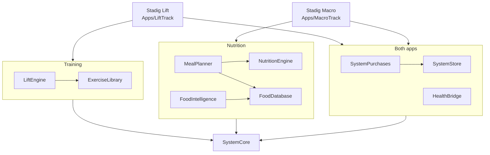

# Architecture

Stadig is two apps, Stadig Lift and Stadig Macro. Each is one multiplatform SwiftUI target for iPhone, iPad, the Mac and Apple Vision Pro, with a Watch app, and each is a thin shell over local Swift packages that hold all the logic.

The code keeps the names it started with: `Apps/LiftTrack`, `Apps/MacroTrack`, `LiftEngine`, `SystemCore` ("the System" was the family's working name). Anything a person reads says Stadig Lift and Stadig Macro.

## The packages



| Package | What it holds |
|---|---|
| `SystemCore` | Shared models and every rule that must give the same answer everywhere, the stats both apps show (`StatsBoard`) among them |
| `ExerciseLibrary` | 332 tagged exercises, substitutions, injury filtering, drills |
| `SystemStore` | Each app's CloudKit-synced database, the shared App Group container (and `FamilySync`, which carries it to the person's other devices), backups, CSV |
| `SystemPurchases` | How each app was paid for (free days, StoreKit, the paywall); switched off, both apps are free |
| `HealthBridge` | HealthKit read and write, and the Watch's live workout session |
| `LiftEngine` | Stadig Lift's engine: gyms, generator, assessment, session planner, live session, analysis |
| `NutritionEngine` | Stadig Macro's engine: weight trend, maintenance, assessment, phase planner, check-ins, targets |
| `FoodDatabase` | The offline food catalogs (USDA, Open Food Facts), search, portions, barcodes, label parsing, and the NIH supplement label catalog with its Supplement Facts parser |
| `FoodIntelligence` | Meal photos, descriptions and label photos through Apple's models; nutrients from the catalog |
| `MealPlanner` | A week of prep-friendly meals sized to the targets, the grocery list and a timed prep day |

## Where code goes

- **One target per app, every platform.** Screens choose layouts by size class: compact keeps the iPhone design, and regular (iPad, the Mac, Vision Pro) gets the desktop one. Platform differences are spelled through `Platform/Adaptive.swift`, not scattered `#if`. Hardware a platform lacks (a camera, Pencil, Health on the Mac) gets that platform's substitute, never a dead control.
- **Logic lives in a package, with tests.** Rules, calculations, planning, parsing, anything with a right answer: the engine package for that app, or `SystemCore` when both apps must agree. Apps hold views, the app model, platform glue (Health, notifications, the camera, widgets) and DEBUG seeding.
- **No third-party dependencies**, in apps or packages. Apple frameworks only.
- **No server.** Each app's data is in its own database, synced through the person's private iCloud database. There are no accounts and no analytics.

## The repository

```
Packages/             Local Swift packages: all the logic, each with its own tests
Apps/<App>/           LiftTrack, MacroTrack: thin SwiftUI shells over the packages
  iOS/                The app for iPhone, iPad, the Mac and Vision Pro (one multiplatform target), one folder
                      per feature; Platform/Adaptive.swift spells what differs between platforms
  Tests/              The app's unit and integration tests (Swift Testing, hosted in the app)
  UITests/            UI tests of first run, the offer and the tabs, and the store screenshots
  Widgets/, Shared/   Widgets and Live Activities, and the snapshot they share with the app
  Watch/, WatchWidgets/   Stadig Lift's and Stadig Macro's Watch apps and their complications
  Records/            Stadig Macro's records that its iPhone and Watch apps both compile
  Catalogs/           Stadig Macro's bundled catalogs (not in git; see the README there)
  Config/             Info plists and entitlements (the Mac's in <App>-macOS.entitlements)
  ci_scripts/         What Xcode Cloud runs around each build (one line each, calling Scripts/xcode-cloud.sh)
  <App>.xcodeproj, <App>.xctestplan, <App>UI.xctestplan   Written by Scripts/generate-project.py: don't edit
Scripts/              build.sh (build, lint, test), generate-project.py, xcode-cloud.sh, the catalog builders
                      and fetch/publish scripts, the icon drawers
docs/                 How the apps work and how to build them
agent-docs/           The working notes coding agents keep: calls to check, and what was verified
Site/                 stadig.dev, the marketing site (Astro; its own README)
Store/                The App Store listing and screenshots: a storeassets project per app and Watch app
.claude/              Skills and hooks for Claude Code sessions
.github/workflows/    GitHub Actions: lint and package tests on every push, the site build
```

## How the apps talk to each other

Through the shared App Group container, which reaches the person's other devices through the family iCloud container (so Stadig Macro on the iPad sees what Stadig Lift wrote on the iPhone). Stadig Macro publishes the nutrition phase and day-by-day logging, and Stadig Lift publishes its training calendar, measurements and strength. Each publishes its stats, which either app can read merged with the other's.

[shared-container.md](shared-container.md) has the contract, and what the hub app and Stadig Mind, which both left this repo, wrote that may still be on devices. Changing a published payload means a schema version bump and a migration test.

## Identifiers

The generator sets `DEVELOPMENT_TEAM` to `9HAG9PT8LJ` for every target.

| | Stadig Lift | Stadig Macro |
|---|---|---|
| Bundle ids | `dev.svindland.stadig.lift` (`.widgets`, `.watchkitapp`, `.watchkitapp.widgets`) | `dev.svindland.stadig.macro` (`.widgets`, `.watchkitapp`, `.watchkitapp.widgets`) |
| iCloud containers | `iCloud.dev.svindland.stadig.lift`, and the family's `iCloud.dev.svindland.stadig` | `iCloud.dev.svindland.stadig.macro`, and the family's |
| App Group | `group.dev.svindland.stadig`, shared by the whole family | same |
| In-app purchases (off) | `dev.svindland.stadig.lift.unlock` (non-consumable), `dev.svindland.stadig.lift.monthly` (subscription) | `dev.svindland.stadig.macro.unlock` (non-consumable), `dev.svindland.stadig.macro.monthly` (subscription) |
| URL scheme | `lifttrack://start` | `macrotrack://log`, `scan`, `camera`, `describe`, `quickadd`, `weigh`, `plan`, `supplements` |

Each bundle id covers the iPhone, iPad, Mac and Vision Pro builds. The ids moved under `dev.svindland.stadig` on 2026-10-18, before anything reached App Store Connect. Before that they were `dev.svindland.lifttrack`, `macrotrack` and `group.dev.svindland.system`. Health still treats samples from the old ids as the app's own (`AppModel.ownBundlePrefixes`).
